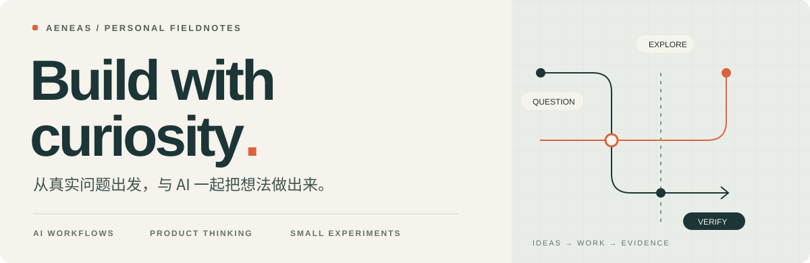

  

  <a href="https://hxy-asdw.github.io/"><strong>个人实验室 ↗</strong></a>
  &nbsp; / &nbsp;
  <a href="#selected-work">精选作品</a>
  &nbsp; / &nbsp;
  <a href="#open-source">开源贡献</a>
  &nbsp; / &nbsp;
  <a href="mailto:2870854049@qq.com">联系我</a>

### 我是 Aeneas

我关注 **AI Agent、业务产品和数据分析**，也会因为好奇去做一个游戏、拆解一个工作流。

我喜欢从具体问题开始：这个流程到底帮谁？规则有没有说清楚？AI 给出的结果，怎样才能验证？然后把需求拆成能实现、能检查、能继续迭代的小任务。

在项目中，我主要承担需求梳理、业务判断、组织 AI 实现与验收反馈；代码与自动化主要由 AI 辅助完成。这里记录作品，也保留探索的过程。

### Selected work / 从问题到作品

<table>
<tr>
<td width="50%" valign="top">

**01 / Agent × 数据分析**

#### [Excel Data Report](https://github.com/hxy-asdw/excel-data-report)

让表格分析留下可以核对的过程。

从 Excel / CSV 到 HTML 报告：脚本负责统计与图表，LLM 负责规划和解读，数字审计与复核串起整个流程。

公开工具 · Python · Agent Skill

</td>
<td width="50%" valign="top">

**02 / 数据 × 业务判断**

#### [Olist 商业分析](https://github.com/hxy-asdw/olist-business-analysis-report)

从订单延迟，一路追到复购、卖家与地域差异。

基于公开电商数据整理分析路径，产出包含 19 张交互图表与 12 条业务建议的报告。

公开报告 · 历史数据研究 · 统计关联

</td>
</tr>
<tr>
<td width="50%" valign="top">

**03 / 工作流 × 可靠性**

#### AI Workflow Quality Gate

工作流返回成功之后，还要检查什么？

围绕退款场景，探索固定预期、权限、幂等与故障恢复。基础联调已验收，最后一轮故障测试的正式审查待完成。

私有实验 · Dify / Python / SQLite

</td>
<td width="50%" valign="top">

**04 / 交互 × 游戏体验**

#### [Ashline](https://hxy-asdw.github.io/lab/ashline/)

用一小组战斗动作，探索对决的节奏。

围绕耐力、格挡、闪避与轻重攻击迭代体验。浏览器可玩原型，持续开发中。

[进入试玩 ↗](https://hxy-asdw.github.io/games/ashline/)

游戏原型 · AI 辅助开发

</td>
</tr>
</table>

### Open source / 小修复，真实合并

| 项目 | 贡献 | 状态 |
| :--- | :--- | :--- |
| **Storybook** | [修复代码高亮与系统深浅色模式不一致的问题 #35541](https://github.com/storybookjs/storybook/pull/35541) | Merged |
| **Recharts** | [修复 Tooltip 标签查找未命中时的数据回退，并补充回归测试 #7573](https://github.com/recharts/recharts/pull/7573) | Merged |

以上贡献均以 AI 辅助方式推进；链接保留上游讨论与改动记录。

### In practice / 在真实业务里继续打磨

近期参与住宿预订小程序、协会会员资源协作平台与企业展示网站，围绕预订与后台流程、会员与资源撮合、内容展示和客户反馈持续迭代。项目分别处于开发、联调或客户评审阶段。

我在这些实践中持续学习：把口头需求变成明确规则，让页面、后台与业务流程衔接，并把“实现了”和“验证了”分别说清楚。

### Working notes / 我在意的事

- **先弄清问题**：从使用者、业务规则与验收结果出发。
- **让 AI 的结果可检查**：计算留给脚本，判断保留依据，失败也留下记录。
- **做小、做完、再迭代**：用 Git 保存检查点，把真实项目中的经验整理成可复用笔记。

---

  <strong>Persist through what is seen.</strong> 
  保持好奇，把看到的问题继续做下去。

